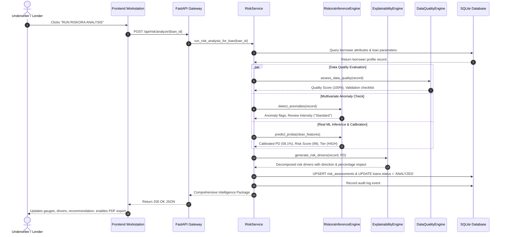

# RISKORA : System Architecture & Technical Design

## 1. System Topology Overview

RISKORA is built with a decoupled, high-performance, and modular architecture designed for institutional digital micro-lending risk intelligence:

```
┌─────────────────────────────────────────────────────────────────────────────┐
│                            PRESENTATION LAYER                               │
│       Institutional Financial Workstation (HTML5 / Modern ES6 / Chart.js)   │
│   [Borrower Store] [Risk Dossier] [Simulator] [Syndicate] [Repayment Desk]  │
└──────────────────────────────────────┬──────────────────────────────────────┘
                                       │ REST / JSON (FastAPI)
┌──────────────────────────────────────▼──────────────────────────────────────┐
│                              API GATEWAY                                    │
│                 FastAPI Async Server & Static Asset Mount                   │
│         CORS Middleware • Pydantic Schema Validation • Auth & Audit         │
└───────────────────┬──────────────────────────────────┬──────────────────────┘
                    │                                  │
┌───────────────────▼──────────────────────┐ ┌─────────▼──────────────────────┐
│           APPLICATION SERVICES           │ │       ML INTELLIGENCE CORE     │
│ • LoanService (Marketplace & Catalog)    │ │ • Model Training Pipeline      │
│ • FundingService (Syndicate & HHI)       │ │ • Calibrated Inference Engine  │
│ • RepaymentService (Amortization & LCF)  │ │ • Explainable AI (XAI Drivers) │
│ • SimulationService (Counterfactuals)    │ │ • Data Quality Engine (0-100%) │
│ • DatasetService (CSV Auto-Mapping)      │ │ • Anomaly Detection Engine     │
│ • ReportService (ReportLab PDF Engine)   │ └──────────────────┬───────────────┘
└───────────────────┬──────────────────────┘                    │
                    │                                           │ Artifacts (.joblib)
┌───────────────────▼───────────────────────────────────────────▼─────────────┐
│                          PERSISTENCE LAYER (SQLite)                         │
│  borrowers • loans • risk_assessments • funding_positions • schedules      │
│            repayments • datasets • lenders • audit_logs                     │
└─────────────────────────────────────────────────────────────────────────────┘
```

---

## 2. End-to-End Sequence: Real ML Risk Assessment



---

## 3. Financial Amortization & Allocation Waterfall Architecture

### Amortization Math
Instalments are computed via standard equal annuity formulas:
$$EMI = P \times \frac{r(1+r)^n}{(1+r)^n - 1}$$
where:
- $P$ = Principal loan amount
- $r$ = Periodic interest rate ($\frac{APR}{12}$ for monthly, $\frac{APR}{24}$ for bi-monthly)
- $n$ = Total scheduled payments

In each payment period $k$:
$$\text{Interest}_k = \text{Outstanding Principal}_{k-1} \times r$$
$$\text{Principal}_k = EMI - \text{Interest}_k$$
In the terminal period $n$, final principal is balanced to exactly match the remaining balance, ensuring **₹0.00 final settlement**.

### Allocation Waterfall Policies
When a borrower submits repayment amount $A$:
1. **Pro-Rata Allocation:**
   $$\text{Payout}_i = A \times \frac{C_i}{\sum C}$$
   Residual pennies are absorbed by the lead investor.
2. **Largest Contribution First (LCF):**
   Prioritized principal waterfall extinguishing largest outstanding capital contributions first.
3. **Earliest Funding First (EFF):**
   Time-priority waterfall extinguishing earlier commitments first.

---

## 4. Separation of Concerns & Directory Structure

```text
riskora/
├── ml/                         # Core Machine Learning & Data Science Layer
│   ├── dataset_generator.py    # Generates realistic benchmark micro-lending data
│   ├── train_models.py         # Multi-candidate model training, calibration & selection
│   ├── inference_engine.py     # Real-time calibrated model inference engine
│   ├── explainability.py       # Local feature attributions & risk drivers
│   ├── data_quality.py         # Independent data quality validation engine
│   └── anomaly_detector.py     # Multivariate anomaly and outlier detector
├── backend/                    # Backend API and Domain Services
│   ├── database.py             # SQLite relational database schema and seeding
│   ├── schemas.py              # Pydantic v2 schemas and validation DTOs
│   ├── main.py                 # FastAPI application, route mounting, and middleware
│   └── services/
│       ├── loan_service.py     # Marketplace query, search, filtering, and CRUD
│       ├── risk_service.py     # Risk analysis orchestration and portfolio aggregates
│       ├── funding_service.py  # Single vs. fractional syndication and HHI metrics
│       ├── repayment_service.py# Amortization generator and allocation waterfalls
│       ├── simulation_service.py# Counterfactual what-if scenario calculator
│       ├── dataset_service.py  # CSV ingestion, auto-column mapping, validation
│       └── report_service.py   # ReportLab PDF report generation
├── frontend/                   # Institutional Risk Workstation (HTML5 / ES6)
│   ├── index.html              # Multi-module institutional workspace shell
│   ├── styles.css              # Financial design system (Moody's/Bloomberg theme)
│   └── app.js                  # Frontend state controller and Chart.js integration
├── data/                       # Persistent model artifacts and benchmark data
│   ├── champion_model.joblib   # Trained calibrated scikit-learn model artifact
│   ├── model_card.json         # Model governance, metrics, and risk thresholds
│   ├── microlending_benchmark.csv # 6,000-record benchmark dataset
│   └── riskora.db              # SQLite database file
└── tests/                      # Automated Test Suite (Pytest)
    ├── test_ml_pipeline.py     # Unit tests for ML inference, bounds, XAI, DQ
    ├── test_repayment_math.py  # Math tests for amortization and allocation waterfalls
    ├── test_funding_rules.py   # Syndicate limits, overfunding, and HHI tests
    └── test_api_endpoints.py   # Integration tests for all REST API endpoints
```
