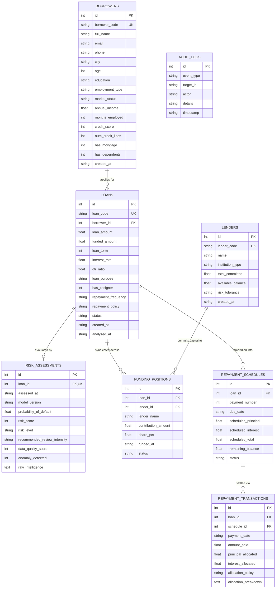

# RISKORA : Relational Database Schema & Data Dictionary

## 1. Relational Topology (SQLite)

The RISKORA relational database is structured with strict foreign key constraints, cascading referential actions, and audit logs.

---

## 2. Table Schemas & Constraints

### 2.1 Table: `borrowers`
Primary identity and demographic data of loan applicants.
- `id`: `INTEGER PRIMARY KEY AUTOINCREMENT`
- `borrower_code`: `TEXT UNIQUE NOT NULL` (e.g. `BR-101`)
- `full_name`: `TEXT NOT NULL`
- `email`: `TEXT`
- `phone`: `TEXT`
- `city`: `TEXT`
- `age`: `INTEGER NOT NULL CHECK(age >= 18 AND age <= 90)`
- `education`: `TEXT NOT NULL`
- `employment_type`: `TEXT NOT NULL`
- `marital_status`: `TEXT NOT NULL`
- `annual_income`: `REAL NOT NULL CHECK(annual_income > 0)`
- `months_employed`: `INTEGER NOT NULL CHECK(months_employed >= 0)`
- `credit_score`: `INTEGER NOT NULL CHECK(credit_score >= 300 AND credit_score <= 850)`
- `num_credit_lines`: `INTEGER NOT NULL CHECK(num_credit_lines >= 0)`
- `has_mortgage`: `INTEGER DEFAULT 0 CHECK(has_mortgage IN (0, 1))`
- `has_dependents`: `INTEGER DEFAULT 0 CHECK(has_dependents IN (0, 1))`
- `created_at`: `TEXT NOT NULL` (ISO-8601 UTC)

### 2.2 Table: `loans`
Micro-loan applications and current status lifecycle.
- `id`: `INTEGER PRIMARY KEY AUTOINCREMENT`
- `loan_code`: `TEXT UNIQUE NOT NULL` (e.g. `LN-2026-001`)
- `borrower_id`: `INTEGER NOT NULL REFERENCES borrowers(id) ON DELETE CASCADE`
- `loan_amount`: `REAL NOT NULL CHECK(loan_amount > 0)`
- `funded_amount`: `REAL DEFAULT 0.0 CHECK(funded_amount >= 0.0)`
- `loan_term`: `INTEGER NOT NULL CHECK(loan_term >= 1)`
- `interest_rate`: `REAL NOT NULL CHECK(interest_rate > 0.0)`
- `dti_ratio`: `REAL NOT NULL CHECK(dti_ratio >= 0.0)`
- `loan_purpose`: `TEXT NOT NULL`
- `has_cosigner`: `INTEGER DEFAULT 0 CHECK(has_cosigner IN (0, 1))`
- `repayment_frequency`: `TEXT DEFAULT 'MONTHLY'` (`MONTHLY`, `BI_MONTHLY`, `CUSTOM_FIXED`, `FLEXIBLE_WINDOW`)
- `repayment_policy`: `TEXT DEFAULT 'PRO_RATA'` (`PRO_RATA`, `LARGEST_CONTRIBUTION_FIRST`, `EARLIEST_FUNDING_FIRST`)
- `status`: `TEXT DEFAULT 'APPLIED'` (`APPLIED`, `ANALYZED`, `FUNDING`, `FULLY_FUNDED`, `ACTIVE`, `COMPLETED`, `DEFAULTED`)
- `created_at`: `TEXT NOT NULL`
- `analyzed_at`: `TEXT`

### 2.3 Table: `risk_assessments`
Stores immutable ML inference records, scores, and explainability packages.
- `id`: `INTEGER PRIMARY KEY AUTOINCREMENT`
- `loan_id`: `INTEGER UNIQUE NOT NULL REFERENCES loans(id) ON DELETE CASCADE`
- `assessed_at`: `TEXT NOT NULL`
- `model_version`: `TEXT NOT NULL`
- `probability_of_default`: `REAL NOT NULL CHECK(probability_of_default >= 0.0 AND probability_of_default <= 1.0)`
- `risk_score`: `INTEGER NOT NULL CHECK(risk_score >= 0 AND risk_score <= 100)`
- `risk_level`: `TEXT NOT NULL` (`LOW`, `MEDIUM`, `HIGH`)
- `recommended_review_intensity`: `TEXT NOT NULL` (`Standard`, `Enhanced Verification`, `Credit Committee Review`)
- `data_quality_score`: `INTEGER NOT NULL CHECK(data_quality_score >= 0 AND data_quality_score <= 100)`
- `anomaly_detected`: `INTEGER NOT NULL CHECK(anomaly_detected IN (0, 1))`
- `raw_intelligence`: `TEXT NOT NULL` (Full JSON payload of XAI drivers, anomaly checks, and recommendations)

### 2.4 Table: `funding_positions`
Tracks committed capital positions within loan syndicates.
- `id`: `INTEGER PRIMARY KEY AUTOINCREMENT`
- `loan_id`: `INTEGER NOT NULL REFERENCES loans(id) ON DELETE CASCADE`
- `lender_id`: `INTEGER NOT NULL REFERENCES lenders(id) ON DELETE CASCADE`
- `lender_name`: `TEXT NOT NULL`
- `contribution_amount`: `REAL NOT NULL CHECK(contribution_amount > 0)`
- `share_pct`: `REAL NOT NULL`
- `funded_at`: `TEXT NOT NULL`
- `status`: `TEXT DEFAULT 'COMMITTED'`

### 2.5 Table: `repayment_schedules`
Contains mathematically exact amortized schedules.
- `id`: `INTEGER PRIMARY KEY AUTOINCREMENT`
- `loan_id`: `INTEGER NOT NULL REFERENCES loans(id) ON DELETE CASCADE`
- `payment_number`: `INTEGER NOT NULL`
- `due_date`: `TEXT NOT NULL`
- `scheduled_principal`: `REAL NOT NULL`
- `scheduled_interest`: `REAL NOT NULL`
- `scheduled_total`: `REAL NOT NULL`
- `remaining_balance`: `REAL NOT NULL`
- `status`: `TEXT DEFAULT 'PENDING'` (`PENDING`, `PAID`, `PARTIAL`, `OVERDUE`)

### 2.6 Table: `repayment_transactions`
Auditable logs of executed borrower repayments with allocation breakdowns.
- `id`: `INTEGER PRIMARY KEY AUTOINCREMENT`
- `loan_id`: `INTEGER NOT NULL REFERENCES loans(id) ON DELETE CASCADE`
- `schedule_id`: `INTEGER REFERENCES repayment_schedules(id)`
- `payment_date`: `TEXT NOT NULL`
- `amount_paid`: `REAL NOT NULL CHECK(amount_paid > 0)`
- `principal_allocated`: `REAL NOT NULL`
- `interest_allocated`: `REAL NOT NULL`
- `allocation_policy`: `TEXT NOT NULL`
- `allocation_breakdown`: `TEXT NOT NULL` (JSON array of payouts per syndicate lender)

### 2.7 Table: `lenders`
Institutional and private capital providers.
- `id`: `INTEGER PRIMARY KEY AUTOINCREMENT`
- `lender_code`: `TEXT UNIQUE NOT NULL`
- `name`: `TEXT NOT NULL`
- `institution_type`: `TEXT DEFAULT 'Private Syndicate'`
- `total_committed`: `REAL DEFAULT 1000000.0`
- `available_balance`: `REAL DEFAULT 750000.0`
- `risk_tolerance`: `TEXT DEFAULT 'BALANCED'`
- `created_at`: `TEXT NOT NULL`

### 2.8 Table: `audit_logs`
System activity audit trail.
- `id`: `INTEGER PRIMARY KEY AUTOINCREMENT`
- `event_type`: `TEXT NOT NULL`
- `target_id`: `TEXT NOT NULL`
- `actor`: `TEXT NOT NULL`
- `details`: `TEXT NOT NULL`
- `timestamp`: `TEXT NOT NULL`
